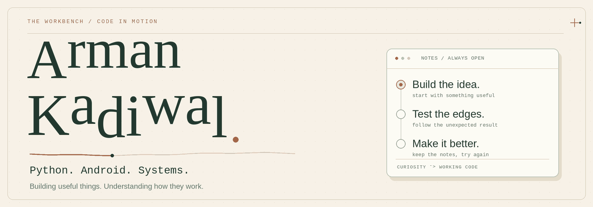
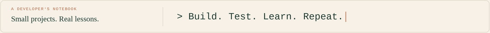
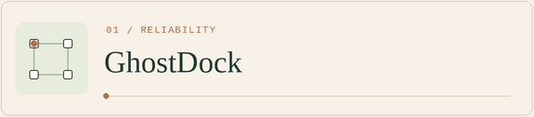
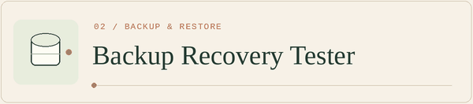
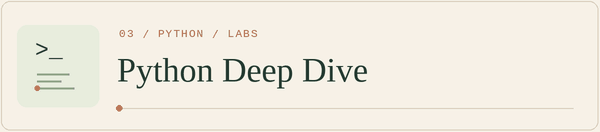
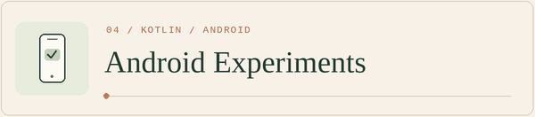
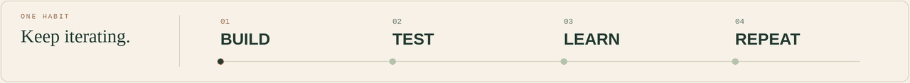

  <picture>
    <source media="(max-width: 700px) and (prefers-reduced-motion: reduce)" srcset="./assets/motion/hero-mobile-still.png" />
    <source media="(prefers-reduced-motion: reduce)" srcset="./assets/motion/hero-still.png" />
    <source media="(max-width: 700px)" srcset="./assets/motion/hero-mobile.gif" />
    
  </picture>

  <picture>
    <source media="(max-width: 700px) and (prefers-reduced-motion: reduce)" srcset="./assets/motion/intro-mobile-still.png" />
    <source media="(prefers-reduced-motion: reduce)" srcset="./assets/motion/intro-still.png" />
    <source media="(max-width: 700px)" srcset="./assets/motion/intro-mobile.gif" />
    
  </picture>

I learn best by **building something, finding the parts that break, and fixing them**. That curiosity has taken me from Python exercises and Android experiments to tools for backup verification and service recovery.

Some projects are polished. Others are still experiments. I try to make the distinction clear.

### Selected work

<table>
<tr>
<td width="50%" valign="top">
<a href="https://github.com/ARMAN-KADIWAL/GhostDock">
<picture>
  <source media="(prefers-reduced-motion: reduce)" srcset="./assets/motion/ghostdock-still.png" />
  
</picture>
</a>
  
A small recovery system for Docker services. It checks health, makes a bounded restart attempt, and produces a record of what actually happened.  
<code>Python</code> <code>Docker</code> <code>AWS / SSM</code>  
Local demo available. Live AWS acceptance testing is still pending.  
<a href="https://github.com/ARMAN-KADIWAL/GhostDock"><b>Explore GhostDock →</b></a>
</td>
<td width="50%" valign="top">
<a href="https://github.com/ARMAN-KADIWAL/backup-automation">
<picture>
  <source media="(prefers-reduced-motion: reduce)" srcset="./assets/motion/backup-still.png" />
  
</picture>
</a>
  
Because a backup isn't much use if you can't restore it. This project checks SQLite backup integrity and creates repeatable restoration reports.  
<code>Python</code> <code>SQLite</code> <code>Testing</code>  
Local backup verification, not a managed cloud backup service.  
<a href="https://github.com/ARMAN-KADIWAL/backup-automation"><b>Explore the backup tester →</b></a>
</td>
</tr>
<tr>
<td width="50%" valign="top">
<a href="https://github.com/ARMAN-KADIWAL/python-deep-dive">
<picture>
  <source media="(prefers-reduced-motion: reduce)" srcset="./assets/motion/python-still.png" />
  
</picture>
</a>
  
My hands-on Python labs, from fundamentals and OOP to data analysis, concurrency, async programming and socket networking.  
<code>Python</code> <code>SQLite</code> <code>Pandas</code> <code>Networking</code>  
Labs 75–82 include runnable examples, behavior tests and verification logs.  
<a href="https://github.com/ARMAN-KADIWAL/python-deep-dive"><b>Browse the Python labs →</b></a>
</td>
<td width="50%" valign="top">
<a href="https://github.com/ARMAN-KADIWAL/extra_work_123hy">
<picture>
  <source media="(prefers-reduced-motion: reduce)" srcset="./assets/motion/android-still.png" />
  
</picture>
</a>
  
Native Kotlin prototypes and interaction experiments. A place to explore how apps behave and how to build original versions of an idea.  
<code>Kotlin</code> <code>Android</code>  
Experiments and prototypes, with their current scope described in the repository.  
<a href="https://github.com/ARMAN-KADIWAL/extra_work_123hy"><b>Open the experiment lab →</b></a>
</td>
</tr>
</table>

**Also on the shelf:** [20 classic C & data-structure exercises](https://github.com/ARMAN-KADIWAL/TurboC-Data-Structures-Programs) — sorting, queues, stacks, linked lists, trees, and graphs.

### What I work with

<picture>
  <source media="(max-width: 700px) and (prefers-reduced-motion: reduce)" srcset="./assets/motion/toolkit-mobile-still.png" />
  <source media="(prefers-reduced-motion: reduce)" srcset="./assets/motion/toolkit-still.png" />
  <source media="(max-width: 700px)" srcset="./assets/motion/toolkit-mobile.gif" />
  
</picture>

### One habit I'm trying to keep

<picture>
  <source media="(max-width: 700px) and (prefers-reduced-motion: reduce)" srcset="./assets/motion/method-mobile-still.png" />
  <source media="(prefers-reduced-motion: reduce)" srcset="./assets/motion/method-still.png" />
  <source media="(max-width: 700px)" srcset="./assets/motion/method-mobile.gif" />
  
</picture>

> Make it work → test the awkward cases → understand the failure → leave better notes.

I would rather have a small project with a clear README and reproducible steps than a big one with vague promises.

### Contribution trail

<picture>
  <source media="(prefers-color-scheme: dark)" srcset="https://raw.githubusercontent.com/ARMAN-KADIWAL/ARMAN-KADIWAL/output/snake-dark.svg" />
  <source media="(prefers-color-scheme: light)" srcset="https://raw.githubusercontent.com/ARMAN-KADIWAL/ARMAN-KADIWAL/output/snake.svg" />
  
</picture>

Drawn from my actual contribution calendar. The existing GitHub Actions workflow refreshes it daily.

---

Thanks for dropping by. Browse the code, start with a README, or follow along as these projects improve.

[All repositories](https://github.com/ARMAN-KADIWAL?tab=repositories) · [GhostDock demo](https://github.com/ARMAN-KADIWAL/GhostDock#try-it-in-one-minute) · [How this profile moves](./docs/PROFILE_MAINTENANCE.md)
