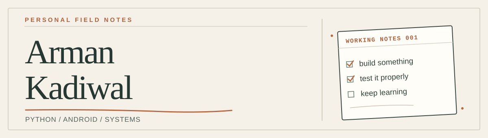

<p align="center">
  
</p>

# Hey, I'm Arman.

I like building things to understand how they work — and then testing what happens when they don't.

I'm learning my way through **Python, Android development, and infrastructure tooling**. Most of my projects start with a practical question: *Can I make this repeatable? How do I know it actually works? What breaks first?*

This GitHub is a workbench, not a highlight reel. You'll find experiments, learning exercises, working prototypes, and the occasional rough edge.

### On my workbench

**01 / [GhostDock](https://github.com/ARMAN-KADIWAL/GhostDock)**  
A recovery prototype for small Docker services. It checks whether an application is healthy, attempts bounded recovery, and writes down what happened. The local demo is runnable; the live AWS recovery path still needs acceptance testing.  
`Python` · `Docker` · `AWS/SSM` · `Testing`

**02 / [Backup Recovery Tester](https://github.com/ARMAN-KADIWAL/backup-automation)**  
An answer to a simple question: *if I back something up today, can I actually restore it tomorrow?* It verifies SQLite backups with restore checks, manifests, checksums, and readable reports.  
`Python` · `SQLite` · `CI`

**03 / [Python Deep Dive](https://github.com/ARMAN-KADIWAL/python-deep-dive)**  
My organized set of hands-on Python labs: fundamentals, OOP, files, SQLite, and Pandas. This is where I practice the basics properly instead of skipping straight to frameworks.  
`Python` · `Pandas` · `Learning by doing`

### Other things I've built

- [Android Experiment Lab](https://github.com/ARMAN-KADIWAL/extra_work_123hy) — Kotlin prototypes, including ChatWave and a small bouncing-ball interaction demo.
- [C & Data Structures Exercises](https://github.com/ARMAN-KADIWAL/TurboC-Data-Structures-Programs) — searching, sorting, stacks, queues, linked lists, trees, and graphs in a legacy Turbo C learning environment.

### A few working habits

I keep coming back to the same loop:

```text
make it work  →  try to break it  →  understand why  →  improve it
```

I care about reproducible steps, readable code, and honest project notes. If something is simulated or untested in production, I try to say so.

**Tools I use:** Python, Kotlin, Bash, Linux, SQLite, Docker, Git, and GitHub Actions.

---

<sub>Thanks for stopping by. If you're curious about a project, open its README — I try to document both how it works and what it doesn't do yet.</sub>

[Browse the repositories](https://github.com/ARMAN-KADIWAL?tab=repositories) · [See my recent work](https://github.com/ARMAN-KADIWAL?tab=overview)
