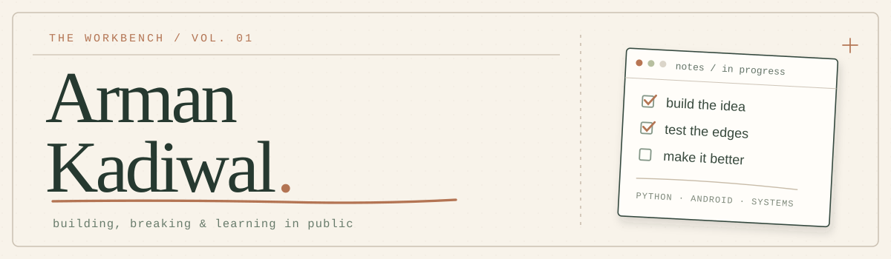

  
  

<h2 align="center">Hey, I'm Arman.</h2>

  

I learn best by **building something, finding the parts that break, and fixing them**. That curiosity has taken me from Python exercises and Android experiments to tools for backup verification and service recovery.

Some projects are polished. Others are still experiments. I try to make the distinction clear.

### Selected work

<table>
<tr>
<td width="50%" valign="top">
01 / RELIABILITY
<h3><a href="https://github.com/ARMAN-KADIWAL/GhostDock">GhostDock</a></h3>
A small recovery system for Docker services. It checks health, makes a bounded restart attempt, and produces a record of what actually happened.  
<code>Python</code> <code>Docker</code> <code>AWS / SSM</code> 
Local demo available. Live AWS acceptance testing is still pending.
</td>
<td width="50%" valign="top">
02 / BACKUP &amp; RESTORE
<h3><a href="https://github.com/ARMAN-KADIWAL/backup-automation">Backup Recovery Tester</a></h3>
Because a backup isn't much use if you can't restore it. This project checks SQLite backup integrity and creates repeatable restoration reports.  
<code>Python</code> <code>SQLite</code> <code>Testing</code> 
Local backup verification, not a managed cloud backup service.
</td>
</tr>
<tr>
<td width="50%" valign="top">
03 / LEARNING LOG
<h3><a href="https://github.com/ARMAN-KADIWAL/python-deep-dive">Python Deep Dive</a></h3>
My hands-on Python labs, from fundamentals and OOP to files, SQL, and Pandas. Small exercises, one concept at a time.  
<code>Python</code> <code>SQLite</code> <code>Pandas</code>
</td>
<td width="50%" valign="top">
04 / SMALL EXPERIMENTS
<h3><a href="https://github.com/ARMAN-KADIWAL/extra_work_123hy">Android Experiment Lab</a></h3>
Native Kotlin prototypes and interaction experiments. A place to explore how apps behave and how to build original versions of an idea.  
<code>Kotlin</code> <code>Android</code>
</td>
</tr>
</table>

**Also on the shelf:** [20 classic C & data-structure exercises](https://github.com/ARMAN-KADIWAL/TurboC-Data-Structures-Programs) — sorting, queues, stacks, linked lists, trees, and graphs.

### What I work with

`Python` · `Kotlin` · `Linux` · `Bash` · `Docker` · `SQLite` · `Git` · `GitHub Actions`

### One habit I'm trying to keep

> Make it work → test the awkward cases → understand the failure → leave better notes.

I would rather have a small project with a clear README and reproducible steps than a big one with vague promises.

<b>Contribution trail</b> — a little motion from my actual GitHub activity

 
<picture>
  <source media="(prefers-color-scheme: dark)" srcset="https://raw.githubusercontent.com/ARMAN-KADIWAL/ARMAN-KADIWAL/output/snake-dark.svg" />
  <source media="(prefers-color-scheme: light)" srcset="https://raw.githubusercontent.com/ARMAN-KADIWAL/ARMAN-KADIWAL/output/snake.svg" />
  
</picture>
 
Generated from the real contribution calendar. Updates automatically when the workflow runs.

---

Thanks for dropping by. Feel free to browse the code, start with a README, or follow along as these projects improve.

[See all repositories](https://github.com/ARMAN-KADIWAL?tab=repositories) · [GhostDock demo](https://github.com/ARMAN-KADIWAL/GhostDock#try-it-in-one-minute)
