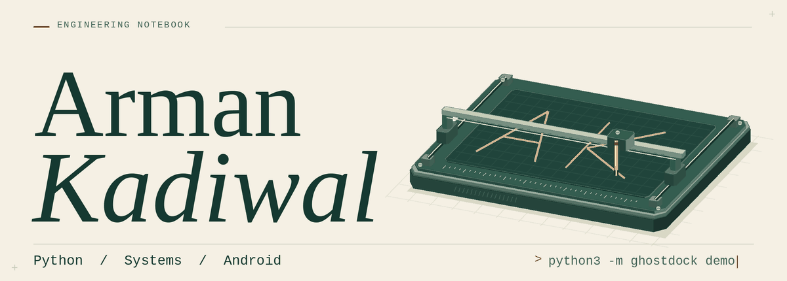
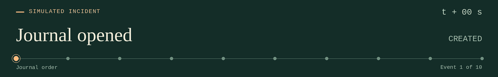
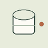
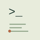

<picture>
  <source media="(prefers-reduced-motion: reduce) and (max-width: 700px) and (prefers-color-scheme: dark)" srcset="https://raw.githubusercontent.com/ARMAN-KADIWAL/ARMAN-KADIWAL/main/assets/workbench/cover-night-mobile-still.png" />
  <source media="(prefers-reduced-motion: reduce) and (max-width: 700px)" srcset="https://raw.githubusercontent.com/ARMAN-KADIWAL/ARMAN-KADIWAL/main/assets/workbench/cover-day-mobile-still.png" />
  <source media="(prefers-reduced-motion: reduce) and (prefers-color-scheme: dark)" srcset="https://raw.githubusercontent.com/ARMAN-KADIWAL/ARMAN-KADIWAL/main/assets/workbench/cover-night-still.png" />
  <source media="(prefers-reduced-motion: reduce)" srcset="https://raw.githubusercontent.com/ARMAN-KADIWAL/ARMAN-KADIWAL/main/assets/workbench/cover-day-still.png" />
  <source media="(max-width: 700px) and (prefers-color-scheme: dark)" srcset="https://raw.githubusercontent.com/ARMAN-KADIWAL/ARMAN-KADIWAL/main/assets/workbench/cover-night-mobile.gif" />
  <source media="(max-width: 700px)" srcset="https://raw.githubusercontent.com/ARMAN-KADIWAL/ARMAN-KADIWAL/main/assets/workbench/cover-day-mobile.gif" />
  <source media="(prefers-color-scheme: dark)" srcset="https://raw.githubusercontent.com/ARMAN-KADIWAL/ARMAN-KADIWAL/main/assets/workbench/cover-night.gif" />
  
</picture>

I’m Arman. I write Python tools to find out whether a service recovered and whether a backup restores the right data. My Android projects are where I experiment with touch and motion.

[GhostDock replay](#ghostdock) · [More projects](#more-projects) · [Contribution trail](#contribution-trail)

## GhostDock

GhostDock began with a Bash exit code. I could tell when a restart command finished. To find out whether the app had recovered, I had to check its HTTP response for the expected app identity.

In this **simulation**, three probes fail. GhostDock tries one local restart, then exercises its EC2 replacement path. The replay follows the ten entries in the saved incident journal. Its clock shows simulated seconds.

<picture>
  <source media="(prefers-reduced-motion: reduce) and (max-width: 700px)" srcset="https://raw.githubusercontent.com/ARMAN-KADIWAL/ARMAN-KADIWAL/main/assets/workbench/replay-mobile-still.png" />
  <source media="(prefers-reduced-motion: reduce)" srcset="https://raw.githubusercontent.com/ARMAN-KADIWAL/ARMAN-KADIWAL/main/assets/workbench/replay-still.png" />
  <source media="(max-width: 700px)" srcset="https://raw.githubusercontent.com/ARMAN-KADIWAL/ARMAN-KADIWAL/main/assets/workbench/replay-mobile.gif" />
  
</picture>

[Run the local demo](https://github.com/ARMAN-KADIWAL/GhostDock#try-it-in-one-minute) · [Read the event journal](https://github.com/ARMAN-KADIWAL/GhostDock/blob/62c1c6c57bd19d5c29d6a08061875d0d2092b5a2/docs/examples/simulated-recovery/events.jsonl) · [Explore the architecture](https://github.com/ARMAN-KADIWAL/GhostDock/blob/main/docs/architecture.md)

<strong>Inspect the ten journal entries</strong>

| Sequence | Demo clock | Recorded state |
| ---: | ---: | --- |
| 0 | 0 s | `CREATED` |
| 1 | 0 s | `WATCHING` |
| 2 | 1 s | `SUSPECT` |
| 3 | 2 s | `SUSPECT` |
| 4 | 3 s | `SUSPECT` |
| 5 | 3 s | `REPAIRING_LOCAL` |
| 6 | 5 s | `CLOUD_PREFLIGHT` |
| 7 | 5 s | `PROVISIONING` |
| 8 | 17 s | `VERIFYING_CLOUD` |
| 9 | 22 s | `RECOVERED_CLOUD` |

The demo records a successful application check through simulated AWS Systems Manager. Live EC2/SSM acceptance testing is still pending. [Validation notes](https://github.com/ARMAN-KADIWAL/GhostDock/blob/main/docs/validation.md)

## More projects

### <picture><source media="(prefers-reduced-motion: reduce)" srcset="https://raw.githubusercontent.com/ARMAN-KADIWAL/ARMAN-KADIWAL/main/assets/workbench/glyph-backup-still.png" /></picture> Backup Recovery Tester

One restore test changes a single order amount and keeps the row count the same. After restoring the SQLite backup, the verifier compares table contents with the saved hashes and catches the change.

[Run the restore demo](https://github.com/ARMAN-KADIWAL/backup-automation#single-command-demo) · [Read the test](https://github.com/ARMAN-KADIWAL/backup-automation/blob/bfd56bca604638ce340b5f53af5694843e454fed/tests/test_core.py#L40)

### <picture><source media="(prefers-reduced-motion: reduce)" srcset="https://raw.githubusercontent.com/ARMAN-KADIWAL/ARMAN-KADIWAL/main/assets/workbench/glyph-python-still.png" /></picture> Python Deep Dive

Lab 82 runs a TCP server that handles multiple clients at once. The validation run for Labs 75–82 passed **55 automated tests and 35 example runs**, including local socket exchanges.

[Open the multi-client lab](https://github.com/ARMAN-KADIWAL/python-deep-dive/tree/main/Lab%2082) · [Check the results](https://github.com/ARMAN-KADIWAL/python-deep-dive/blob/68dcb9dc06aaf7d51a5d87eaf9bb29434f8692a8/progress/labs75-82-verification.json) · [See the Python 3.12 and 3.13 runs](https://github.com/ARMAN-KADIWAL/python-deep-dive/actions/runs/45047194870)

### <picture><source media="(prefers-reduced-motion: reduce)" srcset="https://raw.githubusercontent.com/ARMAN-KADIWAL/ARMAN-KADIWAL/main/assets/workbench/glyph-android-still.png" /></picture> Android experiments

In Bounce Lab, tapping or dragging creates bubbles that fall, squash and rebound on an Android canvas. ChatWave explores a different interaction problem with local conversations, search and reactions.

[Open the Bounce Lab release](https://github.com/ARMAN-KADIWAL/extra_work_123hy/releases/tag/bounce-lab-v1.0.0) · [Read the drawing code](https://github.com/ARMAN-KADIWAL/extra_work_123hy/blob/main/android-bounce-lab/app/src/main/java/com/example/bouncelab/MainActivity.kt) · [Explore ChatWave](https://github.com/ARMAN-KADIWAL/extra_work_123hy#android-project-chatwave)

I also keep my [C and data structure exercises](https://github.com/ARMAN-KADIWAL/TurboC-Data-Structures-Programs) here, from stacks and queues to trees and graphs.

## My tools

<picture>
  <source media="(prefers-reduced-motion: reduce) and (max-width: 700px)" srcset="https://raw.githubusercontent.com/ARMAN-KADIWAL/ARMAN-KADIWAL/main/assets/motion/toolkit-mobile-still.png" />
  <source media="(prefers-reduced-motion: reduce)" srcset="https://raw.githubusercontent.com/ARMAN-KADIWAL/ARMAN-KADIWAL/main/assets/motion/toolkit-still.png" />
  <source media="(max-width: 700px)" srcset="https://raw.githubusercontent.com/ARMAN-KADIWAL/ARMAN-KADIWAL/main/assets/motion/toolkit-mobile.gif" />
  
</picture>

## Contribution trail

<a href="https://github.com/ARMAN-KADIWAL#js-contribution-activity-description">
<picture>
  <source media="(prefers-reduced-motion: reduce)" srcset="https://raw.githubusercontent.com/ARMAN-KADIWAL/ARMAN-KADIWAL/main/assets/workbench/calendar-link.png" />
  <source media="(prefers-color-scheme: dark)" srcset="https://raw.githubusercontent.com/ARMAN-KADIWAL/ARMAN-KADIWAL/output/snake-dark.svg" />
  
</picture>
</a>

[Browse all repositories](https://github.com/ARMAN-KADIWAL?tab=repositories) · [How the artwork is made](./docs/PROFILE_MAINTENANCE.md)
