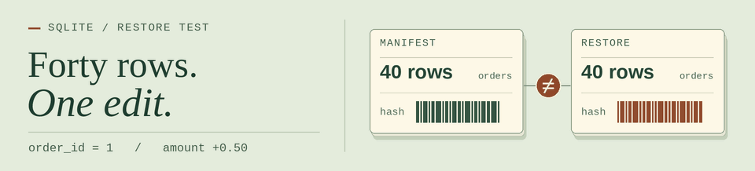
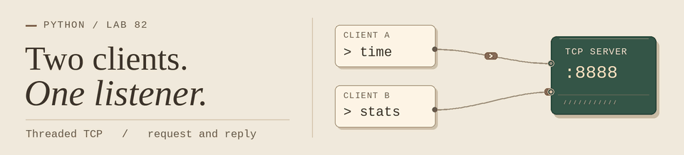
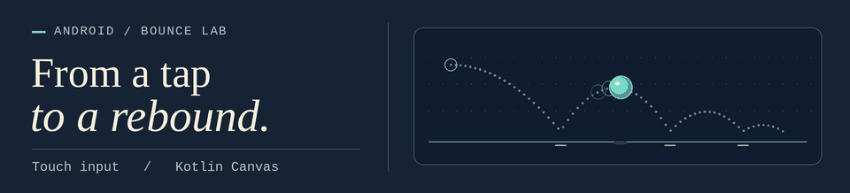
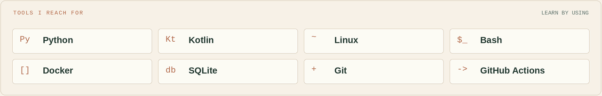

<picture>
  <source media="(prefers-reduced-motion: reduce) and (max-width: 700px) and (prefers-color-scheme: dark)" srcset="https://raw.githubusercontent.com/ARMAN-KADIWAL/ARMAN-KADIWAL/main/assets/workbench/cover-night-mobile-still.png?v=2" />
  <source media="(prefers-reduced-motion: reduce) and (max-width: 700px)" srcset="https://raw.githubusercontent.com/ARMAN-KADIWAL/ARMAN-KADIWAL/main/assets/workbench/cover-day-mobile-still.png?v=2" />
  <source media="(prefers-reduced-motion: reduce) and (prefers-color-scheme: dark)" srcset="https://raw.githubusercontent.com/ARMAN-KADIWAL/ARMAN-KADIWAL/main/assets/workbench/cover-night-still.png?v=2" />
  <source media="(prefers-reduced-motion: reduce)" srcset="https://raw.githubusercontent.com/ARMAN-KADIWAL/ARMAN-KADIWAL/main/assets/workbench/cover-day-still.png?v=2" />
  <source media="(max-width: 700px) and (prefers-color-scheme: dark)" srcset="https://raw.githubusercontent.com/ARMAN-KADIWAL/ARMAN-KADIWAL/main/assets/workbench/cover-night-mobile.gif?v=2" />
  <source media="(max-width: 700px)" srcset="https://raw.githubusercontent.com/ARMAN-KADIWAL/ARMAN-KADIWAL/main/assets/workbench/cover-day-mobile.gif?v=2" />
  <source media="(prefers-color-scheme: dark)" srcset="https://raw.githubusercontent.com/ARMAN-KADIWAL/ARMAN-KADIWAL/main/assets/workbench/cover-night.gif?v=2" />
  
</picture>

I’m Arman. I write Python tools to find out whether a service recovered and whether a backup restores the right data. My Android projects are where I experiment with touch and motion. My current study focus also includes information security and risk-based engineering.

[Current learning](#current-learning-focus) · [Security study](#cissp-study-portfolio) · [Python portfolio](#python-deep-dive) · [GhostDock replay](#ghostdock) · [More projects](#more-projects) · [Contribution trail](#contribution-trail)

## Current learning focus

| Portfolio | Progress |
|---|---|
| [Python Deep Dive](https://github.com/ARMAN-KADIWAL/python-deep-dive) | 94 organized labs · [Capstone](https://github.com/ARMAN-KADIWAL/python-deep-dive/tree/main/Lab%20100) · [Verified results](https://github.com/ARMAN-KADIWAL/python-deep-dive/blob/main/docs/VERIFICATION.md) |
| [CISSP study portfolio](https://github.com/ARMAN-KADIWAL/Certified-Information-Systems-Security-Professional-CISSP-) | 8-domain study roadmap · [Progress tracker](https://github.com/ARMAN-KADIWAL/Certified-Information-Systems-Security-Professional-CISSP-/blob/main/docs/PROGRESS.md) · Learning in progress |

### CISSP study portfolio

 

My next learning focus is information security: understanding risk, secure architecture, identity, network protection, operations and secure software development. I have organized an independent CISSP study repository around the eight official domains, with original study prompts, practical exercise plans and a progress tracker. This is preparation and learning, not a claim of CISSP certification.

[Explore the eight domains](https://github.com/ARMAN-KADIWAL/Certified-Information-Systems-Security-Professional-CISSP-#eight-security-domains) · [Study progress](https://github.com/ARMAN-KADIWAL/Certified-Information-Systems-Security-Professional-CISSP-/blob/main/docs/PROGRESS.md) · [Practice templates](https://github.com/ARMAN-KADIWAL/Certified-Information-Systems-Security-Professional-CISSP-/tree/main/templates)

## GhostDock

GhostDock began with a Bash exit code. I could tell when a restart command finished. To find out whether the app had recovered, I had to check its HTTP response for the expected app identity.

In this **simulation**, three probes fail. GhostDock tries one local restart, then exercises its EC2 replacement path. The replay follows the ten entries in the saved incident journal. Its clock shows simulated seconds.

<picture>
  <source media="(prefers-reduced-motion: reduce) and (max-width: 700px)" srcset="https://raw.githubusercontent.com/ARMAN-KADIWAL/ARMAN-KADIWAL/main/assets/workbench/replay-mobile-still.png" />
  <source media="(prefers-reduced-motion: reduce)" srcset="https://raw.githubusercontent.com/ARMAN-KADIWAL/ARMAN-KADIWAL/main/assets/workbench/replay-still.png" />
  <source media="(max-width: 700px)" srcset="https://raw.githubusercontent.com/ARMAN-KADIWAL/ARMAN-KADIWAL/main/assets/workbench/replay-mobile.gif" />
  
</picture>

[Run the local demo](https://github.com/ARMAN-KADIWAL/GhostDock#try-it-in-one-minute) · [Read the event journal](https://github.com/ARMAN-KADIWAL/GhostDock/blob/62c1c6c57bd19d5c29d6a08061875d0d2092b5a2/docs/examples/simulated-recovery/events.jsonl) · [Explore the architecture](https://github.com/ARMAN-KADIWAL/GhostDock/blob/main/docs/architecture.md)

<strong>Inspect the ten journal entries</strong>

| Sequence | Demo clock | Recorded state |
| ---: | ---: | --- |
| 0 | 0 s | `CREATED` |
| 1 | 0 s | `WATCHING` |
| 2 | 1 s | `SUSPECT` |
| 3 | 2 s | `SUSPECT` |
| 4 | 3 s | `SUSPECT` |
| 5 | 3 s | `REPAIRING_LOCAL` |
| 6 | 5 s | `CLOUD_PREFLIGHT` |
| 7 | 5 s | `PROVISIONING` |
| 8 | 17 s | `VERIFYING_CLOUD` |
| 9 | 22 s | `RECOVERED_CLOUD` |

The demo records a successful application check through simulated AWS Systems Manager. Live EC2/SSM acceptance testing is still pending. [Validation notes](https://github.com/ARMAN-KADIWAL/GhostDock/blob/main/docs/validation.md)

## More projects

### Backup Recovery Tester

<a href="https://github.com/ARMAN-KADIWAL/backup-automation/blob/bfd56bca604638ce340b5f53af5694843e454fed/tests/test_core.py#L40">
<picture>
  <source media="(prefers-reduced-motion: reduce) and (max-width: 700px)" srcset="https://raw.githubusercontent.com/ARMAN-KADIWAL/ARMAN-KADIWAL/main/assets/workbench/study-backup-mobile-still.png" />
  <source media="(prefers-reduced-motion: reduce)" srcset="https://raw.githubusercontent.com/ARMAN-KADIWAL/ARMAN-KADIWAL/main/assets/workbench/study-backup-still.png" />
  <source media="(max-width: 700px)" srcset="https://raw.githubusercontent.com/ARMAN-KADIWAL/ARMAN-KADIWAL/main/assets/workbench/study-backup-mobile.gif" />
  
</picture>
</a>

My restore test adds 0.50 to one order in a 40-row SQLite backup. The row count stays the same. Comparing the restored table with its saved content hash catches the edit.

[Run the restore demo](https://github.com/ARMAN-KADIWAL/backup-automation#single-command-demo) · [Read the test](https://github.com/ARMAN-KADIWAL/backup-automation/blob/bfd56bca604638ce340b5f53af5694843e454fed/tests/test_core.py#L40)

### Python Deep Dive

<a href="https://github.com/ARMAN-KADIWAL/python-deep-dive/tree/main/Lab%2082">
<picture>
  <source media="(prefers-reduced-motion: reduce) and (max-width: 700px)" srcset="https://raw.githubusercontent.com/ARMAN-KADIWAL/ARMAN-KADIWAL/main/assets/workbench/study-python-mobile-still.png" />
  <source media="(prefers-reduced-motion: reduce)" srcset="https://raw.githubusercontent.com/ARMAN-KADIWAL/ARMAN-KADIWAL/main/assets/workbench/study-python-still.png" />
  <source media="(max-width: 700px)" srcset="https://raw.githubusercontent.com/ARMAN-KADIWAL/ARMAN-KADIWAL/main/assets/workbench/study-python-mobile.gif" />
  
</picture>
</a>

Python Deep Dive now contains **94 organized lab folders**, from Python fundamentals through automation, data analysis, Flask, networking, testing and advanced typing. In Lab 82, independent TCP clients exchange messages with the same server. The earlier Labs 75–82 validation recorded 55 automated tests and 35 example runs. The final Task Manager capstone recorded **11 passing tests and 97.58% line coverage** in its linked CI run.

[Explore all 94 labs](https://github.com/ARMAN-KADIWAL/python-deep-dive#complete-lab-index) · [Open the multi-client lab](https://github.com/ARMAN-KADIWAL/python-deep-dive/tree/main/Lab%2082) · [Verification records](https://github.com/ARMAN-KADIWAL/python-deep-dive/blob/main/docs/VERIFICATION.md) · [Capstone](https://github.com/ARMAN-KADIWAL/python-deep-dive/tree/main/Lab%20100) · [Recorded CI results](https://github.com/ARMAN-KADIWAL/python-deep-dive/actions/runs/46041721824)

### Android experiments

<a href="https://github.com/ARMAN-KADIWAL/extra_work_123hy/blob/main/android-bounce-lab/app/src/main/java/com/example/bouncelab/MainActivity.kt">
<picture>
  <source media="(prefers-reduced-motion: reduce) and (max-width: 700px)" srcset="https://raw.githubusercontent.com/ARMAN-KADIWAL/ARMAN-KADIWAL/main/assets/workbench/study-android-mobile-still.png" />
  <source media="(prefers-reduced-motion: reduce)" srcset="https://raw.githubusercontent.com/ARMAN-KADIWAL/ARMAN-KADIWAL/main/assets/workbench/study-android-still.png" />
  <source media="(max-width: 700px)" srcset="https://raw.githubusercontent.com/ARMAN-KADIWAL/ARMAN-KADIWAL/main/assets/workbench/study-android-mobile.gif" />
  
</picture>
</a>

In Bounce Lab, tapping or dragging creates bubbles that fall, squash and rebound on an Android canvas. ChatWave explores a different interaction problem with local conversations, search and reactions.

[Open the Bounce Lab release](https://github.com/ARMAN-KADIWAL/extra_work_123hy/releases/tag/bounce-lab-v1.0.0) · [Read the drawing code](https://github.com/ARMAN-KADIWAL/extra_work_123hy/blob/main/android-bounce-lab/app/src/main/java/com/example/bouncelab/MainActivity.kt) · [Explore ChatWave](https://github.com/ARMAN-KADIWAL/extra_work_123hy#android-project-chatwave)

I also keep my [C and data structure exercises](https://github.com/ARMAN-KADIWAL/TurboC-Data-Structures-Programs) here, from stacks and queues to trees and graphs.

## My tools

<picture>
  <source media="(prefers-reduced-motion: reduce) and (max-width: 700px)" srcset="https://raw.githubusercontent.com/ARMAN-KADIWAL/ARMAN-KADIWAL/main/assets/motion/toolkit-mobile-still.png" />
  <source media="(prefers-reduced-motion: reduce)" srcset="https://raw.githubusercontent.com/ARMAN-KADIWAL/ARMAN-KADIWAL/main/assets/motion/toolkit-still.png" />
  <source media="(max-width: 700px)" srcset="https://raw.githubusercontent.com/ARMAN-KADIWAL/ARMAN-KADIWAL/main/assets/motion/toolkit-mobile.gif" />
  
</picture>

## Contribution trail

<a href="https://github.com/ARMAN-KADIWAL#js-contribution-activity-description">
<picture>
  <source media="(prefers-reduced-motion: reduce)" srcset="https://raw.githubusercontent.com/ARMAN-KADIWAL/ARMAN-KADIWAL/main/assets/workbench/calendar-link.png" />
  <source media="(prefers-color-scheme: dark)" srcset="https://raw.githubusercontent.com/ARMAN-KADIWAL/ARMAN-KADIWAL/output/snake-dark.svg" />
  
</picture>
</a>

[Browse all repositories](https://github.com/ARMAN-KADIWAL?tab=repositories) · [How the artwork is made](./docs/PROFILE_MAINTENANCE.md)
