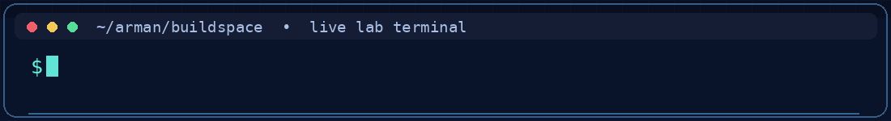

  
  

  

    
    
    
  

## ✦ About me

I'm **Arman**, a developer who likes to turn ideas into working prototypes, test them, and document the results. I build across **Python automation**, **Android/Kotlin**, and **DevOps / reliability tooling**.

- 🔬 **Approach:** reproduce → measure → fix → verify
- 🛠️ **Focus:** recovery systems, Python tooling, learning labs and Android prototypes
- 📖 **Habit:** explain what is tested, what is simulated, and what still needs validation

## ⚡ Featured builds

<table>
<tr>
<td width="50%" valign="top">
<h3><a href="https://github.com/kadiwalarman1-rgb/GhostDock">☁️ GhostDock</a></h3>
<b>Evidence-driven service recovery</b>

Health monitoring, bounded local restart and an optional AWS EC2/SSM recovery path. Generates JSON event journals and HTML recovery receipts.

<code>Python</code> <code>Docker</code> <code>AWS / SSM</code>

Engineering prototype; live AWS acceptance is not yet established.
</td>
<td width="50%" valign="top">
<h3><a href="https://github.com/kadiwalarman1-rgb/backup-automation">🧪 Backup Recovery Tester</a></h3>
<b>Prove that a backup can be restored</b>

SQLite backup verification with manifests, restore checks, integrity validation, test automation and standalone reports.

<code>Python</code> <code>SQLite</code> <code>Docker</code> <code>CI</code>

Local backup/restore validation, not managed cloud backup.
</td>
</tr>
<tr>
<td width="50%" valign="top">
<h3><a href="https://github.com/kadiwalarman1-rgb/python-deep-dive">🐍 Python Deep Dive</a></h3>
<b>Hands-on learning, organized by lab</b>

Practical Python exercises spanning foundations, OOP, files, databases and Pandas, with runnable scripts and lab documentation.

<code>Python</code> <code>SQLite</code> <code>Pandas</code>

</td>
<td width="50%" valign="top">
<h3><a href="https://github.com/kadiwalarman1-rgb/extra_work_123hy">📱 Android Experiment Lab</a></h3>
<b>Original app prototypes</b>

Small Kotlin Android prototypes including ChatWave and Bounce Lab, with source code and build notes.

<code>Kotlin</code> <code>Android</code> <code>UI</code>

</td>
</tr>
</table>

### 🧠 Algorithms & foundations

<a href="https://github.com/kadiwalarman1-rgb/TurboC-Data-Structures-Programs"><b>Turbo C Data Structures Programs</b></a> — 20 C exercises covering sorting, searching, stacks, queues, linked lists, trees and graph traversal.

## 🧰 My engineering toolbox

  
  
  
  
  
  
  

## 🗺️ Repository map

| Track | Repositories | What's inside |
|:--|:--|:--|
| **Reliability & DevOps** | [GhostDock](https://github.com/kadiwalarman1-rgb/GhostDock) · [Backup Recovery Tester](https://github.com/kadiwalarman1-rgb/backup-automation) | Monitoring, recovery, verification |
| **Android experiments** | [Original Android demos](https://github.com/kadiwalarman1-rgb/extra_work_123hy) | Kotlin prototypes and UI experiments |
| **Python practice** | [Python Deep Dive](https://github.com/kadiwalarman1-rgb/python-deep-dive) | Lab-by-lab learning and projects |
| **CS foundations** | [Turbo C DSA](https://github.com/kadiwalarman1-rgb/TurboC-Data-Structures-Programs) | Algorithms and data structures |

> **Engineering principle:** A beautiful README is only a front door. The real proof lives in code, reproducible tests and clear limitations.

  <a href="https://github.com/kadiwalarman1-rgb?tab=repositories"><b>Explore all public repositories</b></a>
    
  

